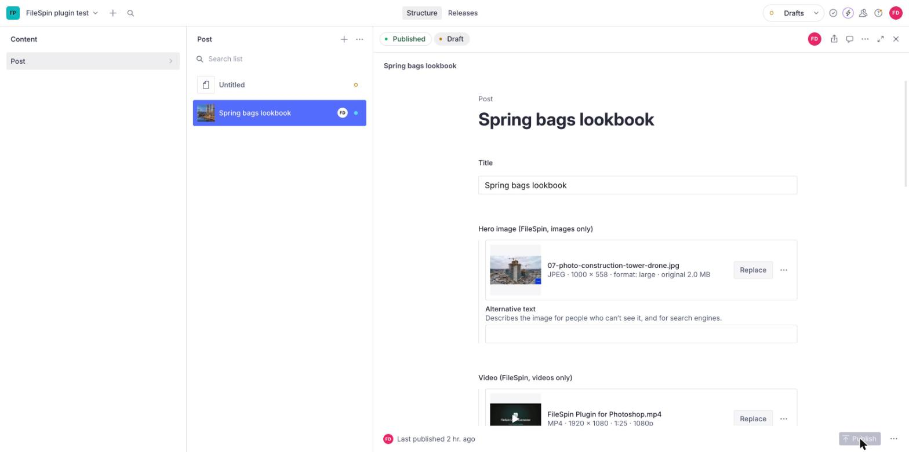
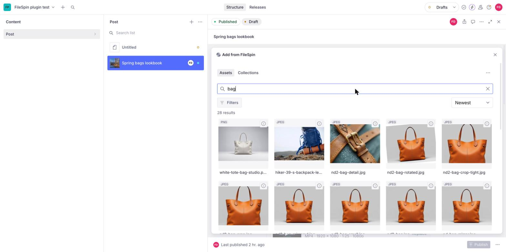

# FileSpin for Sanity

Use images and videos from your [FileSpin](https://filespin.io) library in
Sanity Studio. Editors search FileSpin, filter by type, date or metadata, browse
collections, and pick a file, all without leaving the document they are
editing.





Two ways to use it. You can use both in the same Studio:

| | **FileSpin asset field** (`filespin.asset`) | **FileSpin in Sanity's image picker** |
|---|---|---|
| Where the file lives | Stays in FileSpin | Copied into Sanity |
| Served from | FileSpin CDN (resized on the fly, AVIF/WebP) | Sanity CDN |
| Updates in FileSpin | New uploads of the same asset show up | The copy doesn't change |
| Video | Yes: adaptive streaming (HLS) when the video has a stream, plus a public MP4 version such as 720p | Yes, into `file` fields |
| Best for | New schemas, brand-controlled assets | Existing `image` fields, Sanity hotspot/crop |

Each editor signs in with their own FileSpin account. They see exactly what
that account can see in FileSpin. No API key goes in your code or your dataset.

- Supports Sanity Studio v5 and v6 (React 19)
- Works in light and dark mode
- Read-only: the plugin never changes or deletes anything in FileSpin

## Install

```sh
npm install sanity-plugin-filespin
```

Add it to `sanity.config.ts`:

```ts
import {defineConfig} from 'sanity'
import {filespin} from 'sanity-plugin-filespin'

export default defineConfig({
  // ...
  plugins: [filespin()],
})
```

## Use the FileSpin asset field

Add a field of type `filespin.asset`:

```ts
import {defineField, defineType} from 'sanity'

export const post = defineType({
  name: 'post',
  type: 'document',
  fields: [
    defineField({name: 'title', type: 'string'}),
    defineField({name: 'hero', type: 'filespin.asset', options: {accept: 'image'}}),
    defineField({name: 'video', type: 'filespin.asset', options: {accept: 'video'}}),
    defineField({name: 'gallery', type: 'array', of: [{type: 'filespin.asset'}]}),
  ],
})
```

`options.accept` can be `'image'` or `'video'`. Leave it out to allow both.

Editors press **Choose from FileSpin**, sign in the first time, and click an
asset. The **(i)** button on a tile shows details, metadata and versions. Images
get an alternative text box.

- **Original (web-optimised)** is the default for images. It is not the full
  file: your website gets a copy FileSpin makes on the fly, at the size each
  spot needs (up to 2048 × 1536), as AVIF, WebP or JPEG.
- **Formats** are other versions of the image saved in FileSpin, such as a
  background-removed copy. They are web-optimised the same way. Formats that
  are not public in FileSpin can't be shown on a website, so they can't be
  picked here.
- **Versions** are a video's public MP4 files (1080p, 720p, 480p…). When the
  video also has an adaptive stream (HLS) in FileSpin, the field stores it too.

### What the field stores

```jsonc
{
  "_type": "filespin.asset",
  "assetId": "0ec02ba4…",          // FileSpin asset id
  "name": "spring-campaign.jpg",
  "kind": "image",                 // or "video"
  "contentType": "image/jpeg",
  "width": 2048, "height": 1365,   // size of the file at `url`
  "size": 4810233,                 // bytes of the original
  "duration": 31.5,                // seconds, video only
  "variant": "720p-video.mp4",     // chosen format or video version, if any
  "url": "https://cdn.filespin.io/api/v1/assets/0ec02ba4…/conversions?resize=2048,1365",
  "hlsUrl": "https://cdn.filespin.io/…/transcodes/playlist.m3u8", // video with a stream only
  "posterUrl": "https://cdn.filespin.io/…",  // the image, or a video's poster frame
  "cdn": "https://cdn.filespin.io",
  "version": 3,                    // changes when the file is replaced in FileSpin
  "alt": "Two people on a beach"
}
```

Query it like any object:

```groq
*[_type == "post"]{title, hero, video}
```

### Show it on your website

**Use the helpers from `sanity-plugin-filespin/url`, so each screen gets the
right size.** `url` on its own works, but it is always the largest size (up to
2048 × 1536), so a phone downloads the same image as a desktop. The helpers add
FileSpin's on-demand resize and crop to the URL, the browser picks the size it
needs from `srcset`, and the CDN makes and caches that size. They have no
dependencies and are safe in any frontend:

```tsx
import {filespinImageUrl, filespinSrcSet, filespinVideoSources} from 'sanity-plugin-filespin/url'


<video poster={post.video.posterUrl} controls playsInline>
  {filespinVideoSources(post.video).map((s) => <source key={s.src} {...s} />)}
</video>
```

`filespinVideoSources` lists the adaptive stream (HLS) first when the video has
one, then the MP4. Browsers that play HLS (Safari, iOS, Android, recent Chrome
and Edge) stream at the quality each viewer's connection allows; the rest play
the MP4. No player script needed. `filespinVideoUrl(post.video)` gives the MP4
alone.

| Option | Meaning |
|---|---|
| `width`, `height` | Fit inside this box (FileSpin serves up to 2048 × 1536) |
| `crop` | Fill exactly `width × height`. `true` or `'center'`, `'top'`, `'bottom'`, `'left'`, `'right'`, `'face'` |
| `format` | `'jpg'`, `'png'`, `'webp'`, `'avif'`, `'gif'`. Leave it out and the CDN picks the best one for each browser |
| `quality` | 1–100 |
| `bgcolor` | Fill transparent areas, e.g. `'ffffff'` |

## Use FileSpin in Sanity's image and file pickers

With the plugin installed, every `image` and `file` field gets a **FileSpin**
choice in its **Select** menu. Picking a file there **copies it into Sanity**,
so Sanity's own image tools (hotspot, crop, `@sanity/image-url`) work as
usual. The copy remembers where it came from, so picking the same file again
reuses it.

Don't want copies? Turn it off:

```ts
filespin({assetSource: false})
```

## Settings

```ts
filespin({
  host: 'https://app.filespin.io', // your FileSpin; this is the default
  assetSource: true,               // FileSpin in Sanity's image/file pickers
})
```

On a FileSpin environment other than the standard ones, also set `clientId`
(a public OAuth2 client for that FileSpin) and `cdnHost`. Ask FileSpin support
for these.

## For your FileSpin admin

- **Videos** need a public web version (such as 720p) to be used in the
  FileSpin asset field. Without one, the plugin explains what to do. Make the
  HLS stream public too, for adaptive streaming. Watermarked versions play as
  MP4 only, because the stream has no watermark.
- **Image formats** (custom conversions) must be public to be used in the
  FileSpin asset field. Private ones can still be copied into Sanity.
- Editors see what their own FileSpin role allows. Nobody needs admin rights.

## Privacy and security

- Sign-in uses FileSpin's OAuth2 device flow. A FileSpin tab opens, the editor
  signs in there and presses **Authorize**. The Studio never sees their password.
- The login is kept in the editor's browser (localStorage), per Sanity project
  and user. It is never written to your Sanity dataset or exports. **Sign out
  of FileSpin** in the panel's menu removes it and revokes it at FileSpin.
- The plugin asks only for read access (`read_assets`).
- It talks to your FileSpin host and its CDN, nothing else.
  [Terms](https://filespin.io/terms-conditions) ·
  [Privacy](https://filespin.io/privacy)

## No FileSpin account?

[Start a free trial](https://dashboard.filespin.io/signup?utm_source=sanity&utm_medium=referral&utm_campaign=plugins).

## Support

- Setup guide: <https://developers.filespin.io/guides/sanity/>
- Email: support@filespin.io
- Bugs and ideas: [GitHub issues](https://github.com/FileSpin-io/sanity-plugin-filespin/issues)

## Develop

```sh
npm install
cp test-studio/.env.example test-studio/.env   # set your Sanity project id
npm run dev        # test Studio on http://localhost:3334, plugin from source
npm run lint
npm run build      # verify-package + build to dist/
```

To try the built package in another Studio: `npm run link-watch`, then in that
Studio `npx yalc add sanity-plugin-filespin && npx yalc link sanity-plugin-filespin`.

## License

[MIT](LICENSE) © FileSpin
